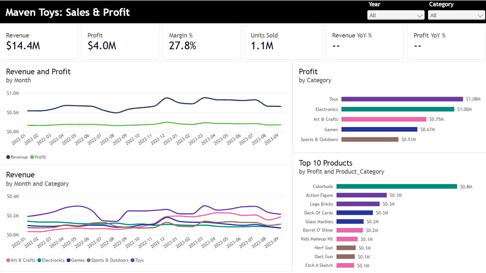
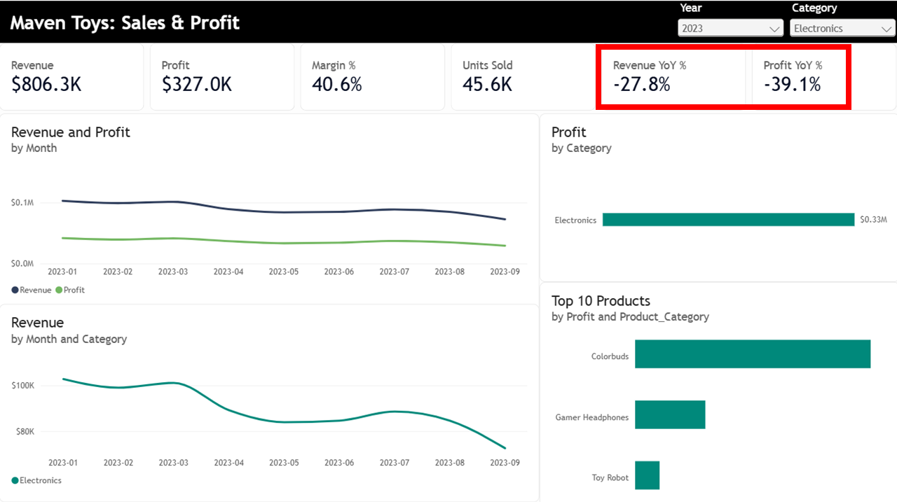
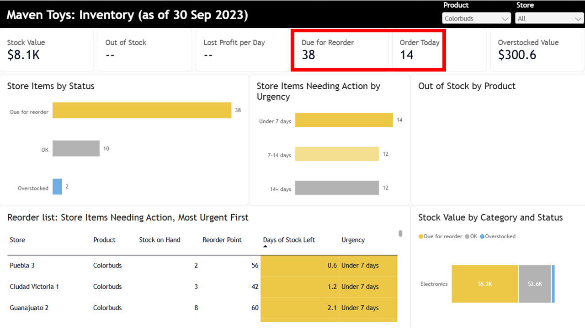
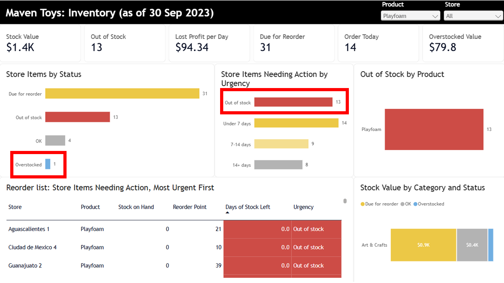
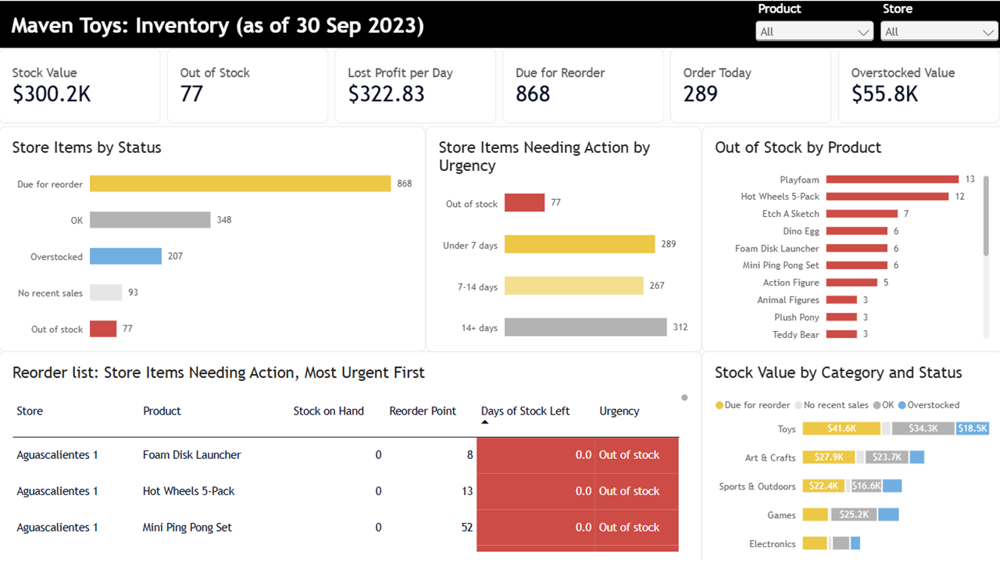
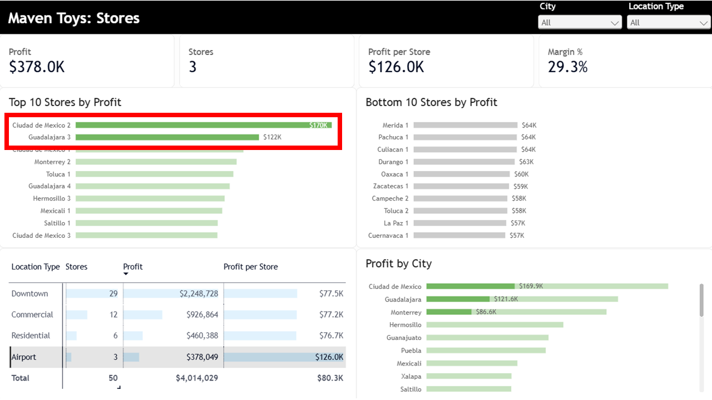
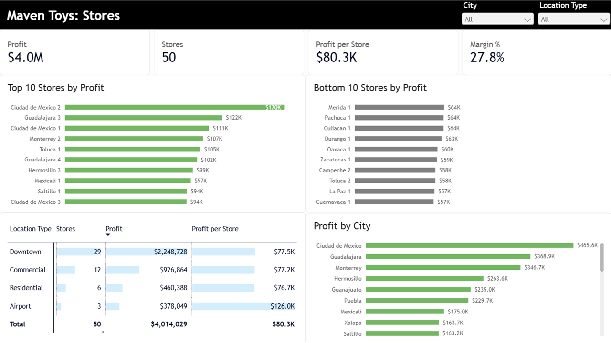
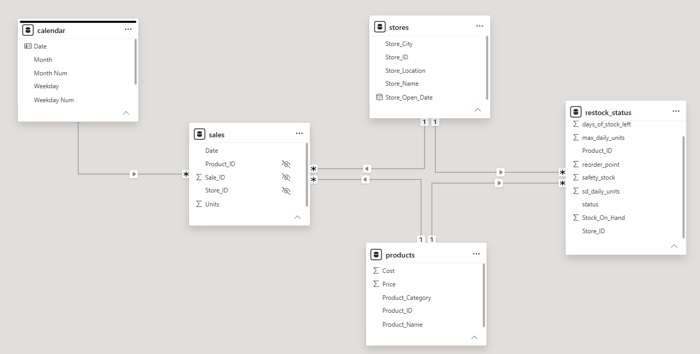
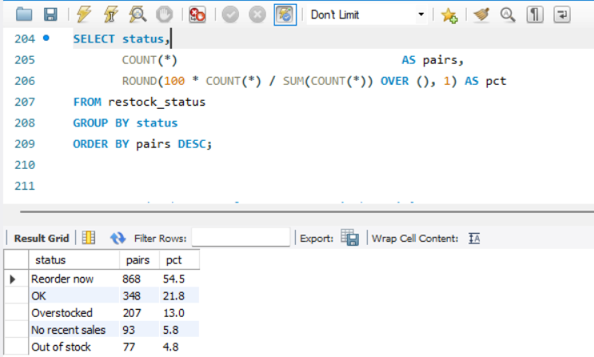

# Maven Toys: Sales, Profit and Inventory Analysis

An analysis of 21 months of sales from **Maven Toys**, a fictional chain of 50 toy stores in Mexico, built in **MySQL** and **Power BI**. It checks the data, measures revenue and profit by store, location and product, flags which products need restocking or are overstocked and what stockouts cost, and presents it all in a three-page interactive dashboard.



---

## The business problem

Maven Toys wants to know:
- Is the business growing, and is the growth profitable?
- Which stores, locations and products earn the most?
- Which products are out of stock, or about to run out, and what does that cost?

## The data

| Table | Rows | What it holds |
|---|---|---|
| `sales` | 829,262 | One row per transaction: date, store, product, units (1 Jan 2022 – 30 Sep 2023) |
| `products` | 35 | Product name, category, cost and price |
| `stores` | 50 | Store name, city, location type (Downtown, Commercial, Residential, Airport), opening date |
| `inventory` | 1,593 | Stock on hand for each store item (a single snapshot) |

A **store item** is one product at one store (for example, Playfoam at La Paz 1). The 50 stores carry 1,593 store items.

Source: [Mexico Toy Sales](https://mavenanalytics.io/data-playground/mexico-toy-sales), Maven Analytics (public domain).

## Findings and recommendations

Year-over-year figures compare January–September 2023 with the same months of 2022. Inventory figures are as of the 30 September 2023 snapshot.

### 1. Profit grew more slowly than revenue because sales moved away from the most profitable category

Revenue grew **30.9%** ($5.3M to $7.0M), but profit grew only **16.0%** ($1.6M to $1.8M), with no new stores opened. Electronics has the highest margin of any category (**40.6%**), yet its revenue fell **27.8%** and its profit **39.1%**. Meanwhile Toys, the biggest category and the one with the lowest margin (**20.4%**), grew revenue by 14.2% but profit by only 6.1%, and Art & Crafts revenue grew **251.9%** at a slightly below-average margin of 26.7%.

**Recommendation:** find out why Electronics sales fell, since it holds the company's most profitable product (finding 2), and review Toys pricing and supplier costs, where a small margin gain would matter most. Track Margin % by category each month.



### 2. Colorbuds is the most profitable product, and 14 stores need to reorder it today

Colorbuds earned about **$0.83M** in profit, about $480K more than the next product. It sells the most units (104K) at a **53.4%** margin, is the top earner in **39 of 50 stores**, and is in the top 3 of every store. As of the snapshot, it was due for reorder in **38 stores**, **14** of which had less than a week of stock left.

**Recommendation:** order Colorbuds for those 14 stores now, and give it a higher safety stock than other products so it never runs out. Track Colorbuds stockouts and days of stock left.



### 3. Stockouts cost about $323 in profit a day, and three products cause about half of it

**77** store items were out of stock, costing about **$322.83** in lost profit a day. Playfoam alone accounts for **$94.34** a day across 13 stores, and with Etch A Sketch and Action Figure ($37.67 each), three products cause about half the total. At the same time, **$72K (24%)** of stock at cost was overstocked ($55.8K, more than 60 days of stock) or had no sales in 90 days ($16.7K).

**Recommendation:** where a product is out at some stores and overstocked at others, move stock before ordering more: Etch A Sketch is out at 7 stores but overstocked at 3. Playfoam and Hot Wheels 5-Pack are overstocked at only one store each, so they need new orders, which points to a supply problem rather than mistakes at individual stores. La Paz 1 and Mexicali 2 have the most products out of stock (5 each) and should be checked first. Discount or bundle the stock with no recent sales. Track Lost Profit per Day and Overstocked Value.



### 4. 868 store items are due for reorder, but only 289 are urgent

**868 of 1,593** store items (55%) were at or below their reorder point. That mostly reflects lean stock: a store item holds about **16 days** of stock on average. Of the 868, **289** had less than 7 days of stock, shorter than the assumed 7-day delivery time, 267 had 7 to 14 days, and 312 had more than 14 days.

**Recommendation:** order the 289 urgent store items today and the 267 this week; the remaining 312 can wait for the regular cycle. Track the Order Today count.



### 5. Airport stores earn about 60% more profit per store than any other location type

The 3 airport stores average **$126K** in profit per store, against about **$77K** for downtown, commercial and residential stores, and the two most profitable stores in the chain (Ciudad de Mexico 2 and Guadalajara 3) are both airport stores. Their margin is only slightly higher (29.3% against 27.4% to 28.3%), so they win mainly by selling more per store. Downtown stores earn the most in total ($2.2M) because there are 29 of them.

**Recommendation:** with only 3 airport stores, test the idea with one more airport location before making it a strategy. Track profit per store by location type.



### 6. Revenue peaked in December 2022 and March 2023, for different reasons

December's peak fits the holiday season. The March 2023 peak came from Sports & Outdoors and Toys only, and the data shows it in one year, so its cause is unknown.

**Recommendation:** stock up and plan staffing before December. Find out what drove March 2023, such as a promotion, a school break or a new product, before planning around it. Track monthly revenue by category.

### Other observations

- **Some high sellers earn very little.** Dino Eggs is the 11th best seller (38K units) but has only a **9.1%** margin.
- **Monthly margin ranged from 32.5% (August 2022) to 25.3% (July 2023).**

## Open questions

- Is Colorbuds also the top product by revenue, or does it earn its profit mainly through margin?
- Do older stores earn more than newer ones? The stores table has opening dates that the dashboard doesn't use yet.
- Did the overall margin decline from 2022 to 2023, or only in some months?

## The dashboard

Three pages built in Power BI, each with its own slicers, a row of KPI cards and four visuals:

| Page | Slicers | Answers |
|---|---|---|
| **Sales & Profit** | Year, Category | Revenue, profit and margin over time; year-over-year growth; profit by category and top 10 products |
| **Stores** | City, Location Type | Top and bottom 10 stores (on the same scale), profit and profit per store by location type, profit by city |
| **Inventory** (as of 30 Sep 2023) | Product, Store | Store items by status and urgency, out-of-stock products, the reorder list (most urgent first), stock value by category and status |

Colours carry meaning: on the Inventory page, red is always out of stock, amber due for reorder (darker when under 7 days), blue overstocked, and grey OK or no recent sales; categories have their own colours that never reuse the status colours.



**Data model:** `sales` is linked to `products`, `stores` and a `calendar` table; `restock_status` (the final restock view from SQL) is a second fact table linked to `products` and `stores`, so one product or store slicer filters both sales and inventory.



## Data checks

Before any analysis, I checked the data in MySQL ([`sql/01_checks.sql`](sql/01_checks.sql)).

**Completeness**
- All four tables imported completely; row counts match the CSV files (sales: 829,262; products: 35; stores: 50; inventory: 1,593).
- Sales run from **1 January 2022 to 30 September 2023**, with sales recorded on every day, so no month is partial. 2023 covers only January to September, so year-over-year comparisons use **January–September of each year**.

**Sales**
- No duplicate sales.
- No missing, zero or negative quantities. The largest sale is 30 units, so there are no unrealistic values.
- Every sale links to a valid product and store.

**Inventory**
- One row per store item (1,593 of the 1,750 possible), with no missing or negative stock values and no links to non-existent stores or products.
- Stock on hand ranges from 0 to 139 units (average 18.7).
- **77 store items had zero stock** on the snapshot date (see finding 3).
- The restock analysis covers **99.8%** of units sold in the last 90 days (161,934 of 162,305). The other 371 units belong to the 23 store items missing from the inventory snapshot (see Limitations).

**In Power BI**
- The city column spells Mexico City as "Cuidad de Mexico"; I corrected it to "Ciudad de Mexico" in Power Query. Store names keep the correct spelling.
- Every store name starts with "Maven Toys", so I shortened the names for display.

**Limitations**
- **41 store items appear in sales but have no inventory record** (0.75% of sales rows, 0.61% of units sold), too few to affect the sales analysis.
  - 18 had no sales in the last 90 days, so they appear to be discontinued at those stores.
  - 23 sold recently, so the inventory snapshot is likely missing them, and the restock analysis can't assess these store items.
- Inventory is a single snapshot, so stock levels over time can't be analysed.
- With only one October–December in the data (2022), holiday seasonality can be suggested but not confirmed.
- The data has no delivery times, so the restock analysis **assumes a 7-day lead time**. It also treats demand over the last 90 days as steady, with no seasonality inside that window.

## Approach

1. **Setup** ([`sql/00_setup.sql`](sql/00_setup.sql)): created the tables, loaded the CSVs with `LOAD DATA`, and converted prices stored as text (`"$9.99 "`) to numbers.
2. **Data checks** ([`sql/01_checks.sql`](sql/01_checks.sql)): completeness, duplicates, invalid values, orphan rows and inventory coverage.
3. **Analysis** ([`sql/02_analysis.sql`](sql/02_analysis.sql)): totals, year-over-year growth, and profit by store, location type, category and product, including a window function (`RANK()`) for each store's top products.
4. **Restock** ([`sql/03_restock.sql`](sql/03_restock.sql)): daily demand for each store item over the last 90 days, a safety stock and reorder point for each (95% service level), a status for each (Reorder now, Out of stock, Overstocked, No recent sales, OK), and the cost of stockouts and of stock that isn't selling. The dashboard shows "Reorder now" as "Due for reorder".
5. **Dashboard** ([`powerbi/maven-toys.pbix`](powerbi/maven-toys.pbix)): loaded the CSVs and the restock view into Power BI, cleaned names in Power Query, built a calendar table and the model, wrote DAX measures (revenue, profit, margin, year-over-year growth, profit per store, lost profit per day, store items by urgency), and built the three pages.

Every query in the `.sql` files starts with the question it answers (`-- Q:`) and its result (`-- A:`), so you can read the answers and rerun any query to check them.



## Challenges and what I learned

- **Prices stored as text.** Costs and prices came as text like `"$9.99 "`, so I loaded them as text and converted them with `REPLACE`, `TRIM` and `CAST`, keeping the original columns.
- **Estimated vs. exact row counts.** MySQL Workbench showed 827,717 rows for `sales`, but `COUNT(*)` returned 829,262, matching the CSV. The Workbench figure is an estimate from sampled data pages, so I rely on `COUNT(*)`.
- **Questioning the question.** I first planned to find seasonality in SQL, but a 105-row result can't be read by eye, so I answered it with a line chart in the dashboard instead.
- **Days with no sales aren't in the data.** A day with zero sales has no row, so `AVG()` would average only the days that had sales and make slow sellers look many times faster. I divided each 90-day total by 90 instead.
- **My first reorder rule was too strict.** It based safety stock on each product's single biggest sales day, and it flagged **89%** of store items for reordering, including **494** with more than a month of stock. I replaced it with the standard method, safety stock from the day-to-day standard deviation, which cut the list to **55%** and the store items with a month or more of stock to **45**. Both rules are in `03_restock.sql`, so the comparison can be rerun.
- **Power BI couldn't connect to MySQL.** The MySQL connector failed even on 127.0.0.1, so I loaded the original CSV files instead, plus the restock view exported from MySQL as a CSV.
- **Charts that mislead quietly.** Power BI sorted the month axis by revenue instead of by date, showed year-over-year growth above 100% when no single year was selected (fixed with `HASONEVALUE`), and drew the bottom 10 stores with longer bars than the top 10 because each chart scaled itself. I fixed the sort, blanked the YoY cards unless one year is selected, and gave both store charts the same fixed scale.
- **One colour, one meaning.** My first Inventory page used red for "overstocked" in one chart and "out of stock" in another. I set one colour per status and kept categories in colours that never overlap with them.

## Tools

- **MySQL 8 (MySQL Workbench):** joins, CTEs, views, window functions (`RANK()`, `SUM() OVER ()`), conditional aggregation, data cleaning with `REPLACE`, `TRIM` and `CAST`
- **Power BI:** Power Query, data modelling (a calendar table and two fact tables), DAX measures and calculated columns, conditional formatting, cross-filtering

## Files

```
maven-toys-sales-inventory/
├── README.md
├── data/
│   ├── sales.csv
│   ├── products.csv
│   ├── stores.csv
│   └── inventory.csv
├── sql/
│   ├── 00_setup.sql
│   ├── 01_checks.sql
│   ├── 02_analysis.sql
│   └── 03_restock.sql
├── powerbi/
│   └── maven-toys.pbix
└── images/
    ├── overview.png
    ├── stores.png
    ├── inventory.png
    ├── model.png
    ├── sql-restock-status.png
    ├── finding-electronics.png
    ├── finding-colorbuds.png
    ├── finding-playfoam.png
    └── finding-airports.png
```

## Author

**Marvic Kaizz D.J. Sobreviñas** · Data analyst (career shifter from science teaching)
[LinkedIn](https://www.linkedin.com/in/naisukaizu/) · [GitHub](https://github.com/naisukaizu)
